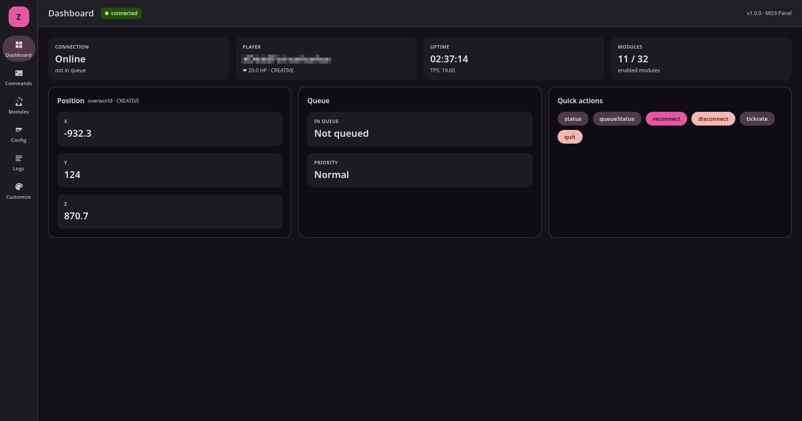
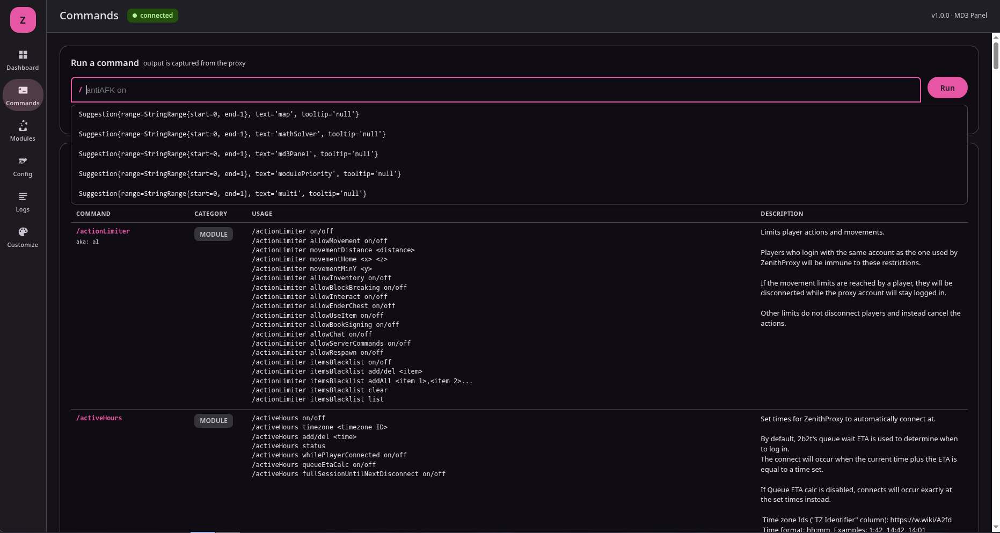
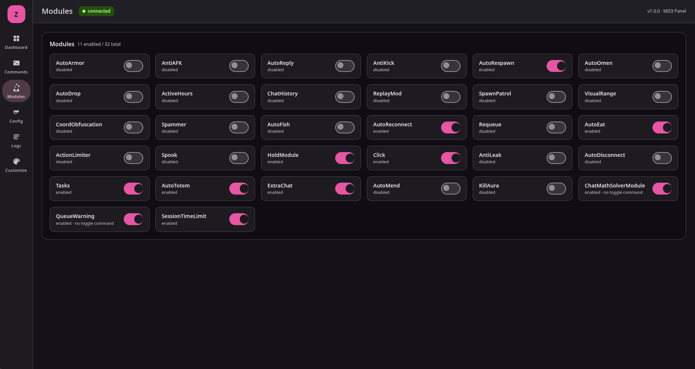
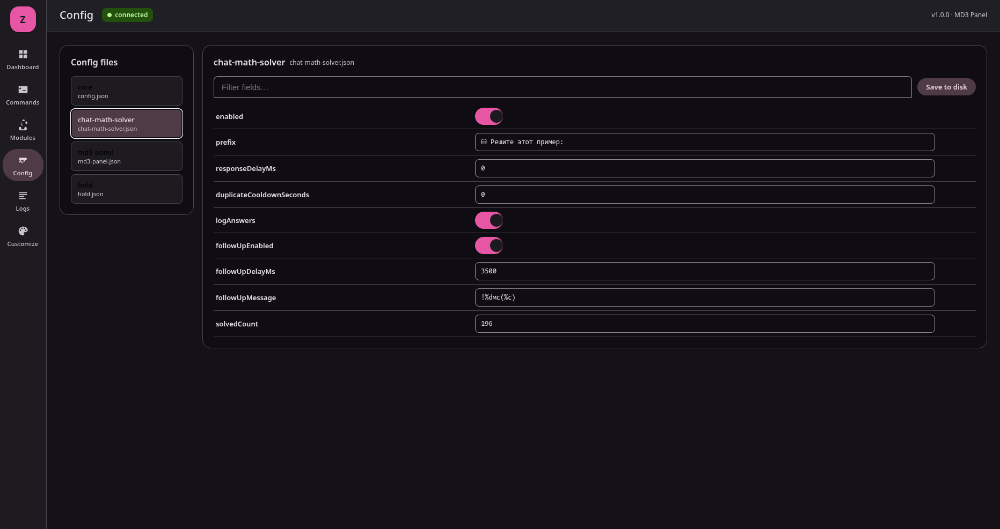
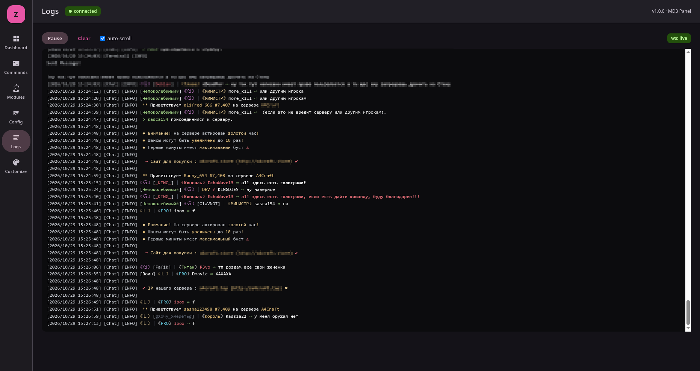
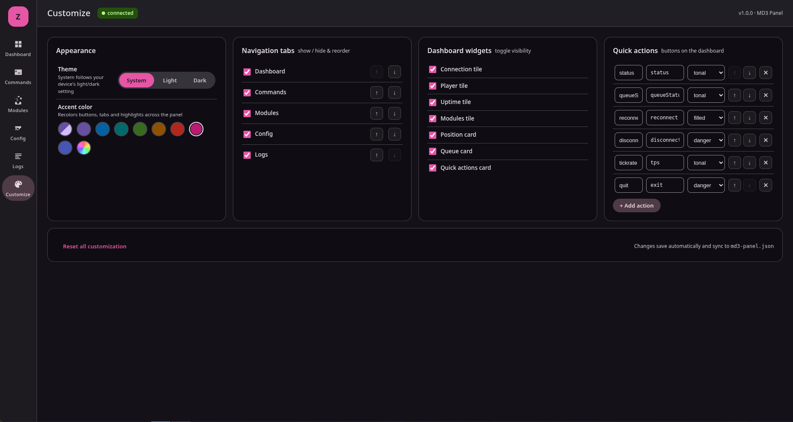

# ZenithProxyMD3Panel

Material Design 3 web panel for ZenithProxy (v1.0.0).

> 🤖 Vibecoded by [OpenCode](https://opencode.ai)

**No authentication** — designed for local/personal use (e.g. accessed from your own phone on your own network). Anyone who can reach the port has full access, so only bind/expose it where you trust the network.

## Features
- **Dashboard** — connection/queue/prio status, player health, position, world, uptime, TPS, module counts, quick-action buttons (`status`, `queueStatus`, `reconnect`, `disconnect`, `tickrate`)
- **Commands** — run any ZenithProxy command with live autocomplete, captured output, command history, and a searchable list of all registered commands
- **Modules** — toggle every module on/off (runs the real module commands under the hood, so config stays in sync)
- **Config** — edit any config file (core `config.json` + all plugin configs) as a flat field list with typed editors (switch/number/text), then save to disk
- **Logs** — live console log tail over WebSocket with ANSI colors, pause/resume, auto-scroll, and gap-resync
- **Customize** — full in-site UI customization (see below), auto-saved to `md3-panel.json`

## Screenshots

| Dashboard | Commands |
| :---: | :---: |
|  |  |

| Modules | Config |
| :---: | :---: |
|  |  |

| Logs | Customize |
| :---: | :---: |
|  |  |

## Customize tab
Everything is edited live on the site itself and auto-saved (debounced) to `plugins/config/md3-panel.json`:

- **Theme** — System / Light / Dark (System follows your device)
- **Accent color** — 8 preset swatches + a custom color picker; recolors buttons, tabs,
  switches and highlights across the whole panel (works in both light and dark mode,
  with automatic contrast adjustment)
- **Navigation tabs** — show/hide any tab and reorder them with ↑/↓ (the Customize tab
  itself is always visible so you can never lock yourself out)
- **Dashboard widgets** — toggle each stat tile and card (connection, player, uptime,
  modules, position, queue, quick actions)
- **Quick actions** — add, remove, reorder, rename; each has a label, a raw ZenithProxy
  command (arguments allowed, e.g. `antiAFK on`), and a style (filled / tonal / outlined / danger)
- **Reset** — one click restores all customization to defaults

## Install
1. Copy `build/libs/ZenithProxyMD3Panel-1.0.0.jar` into ZenithProxy's `plugins/` folder
2. Restart ZenithProxy
3. Open `http://localhost:8090` (default) — no login needed

## In-game / console command
```
md3Panel status                 # url + current settings
md3Panel on/off                 # enable plugin (restart required)
md3Panel port <port>            # change port (restart required)
md3Panel accountOwnerCmds on/off  # allow panel to run owner-only commands
md3Panel logRetention <lines>     # console buffer size (restart required)
```

## Config (`plugins/config/md3-panel.json`)
```json
{
  "enabled": true,
  "port": 8090,
  "commandsAccountOwnerPerms": true,
  "logRetentionEntries": 300,
  "ui": {
    "themeMode": "system",
    "accent": "",
    "tabOrder": ["dash", "commands", "modules", "config", "logs"],
    "hiddenTabs": [],
    "hiddenWidgets": [],
    "quickActions": [
      { "label": "status", "command": "status", "style": "tonal" },
      { "label": "queueStatus", "command": "queueStatus", "style": "tonal" },
      { "label": "reconnect", "command": "reconnect", "style": "filled" },
      { "label": "disconnect", "command": "disconnect", "style": "danger" },
      { "label": "tickrate", "command": "tps", "style": "tonal" }
    ]
  }
}
```
The `ui` block is written by the in-site Customize tab (POST `/api/panel/ui`); the
server validates every value it receives (known tab/widget ids, style whitelist,
list size caps), so the endpoint can't store garbage.

## Build
```
git clone https://github.com/xmusya/ZenithProxy-Panel.git
cd ZenithProxy-Panel
./gradlew build
```
The jar lands in `build/libs/ZenithProxyMD3Panel-1.0.0.jar`.
Requires Java 25 (the Gradle wrapper picks a compatible JDK automatically).

Javalin 7 is shaded and relocated into `dev.zenith.md3panel.shadow.*` (same approach as the official ZenithProxyWebAPI), so it can't clash with other plugins.

## Notes
- Module toggles use each module's own command (`antiAFK on`, `killAura off`, ...). Modules without a matching command show as non-toggleable.
- Config edits apply to the live in-memory config immediately; press **Save to disk** to persist. Module enable/disable state is best changed from the Modules tab (it also syncs the module state).
- Arrays and nested object leaves can't be edited directly — edit their sub-fields.

## License
MIT

